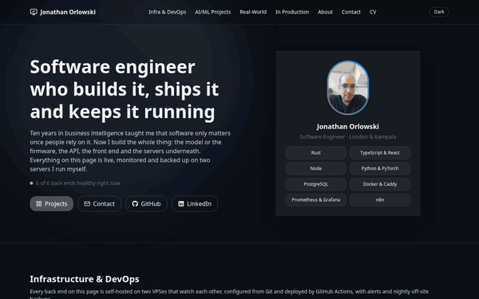

# Personal Website – Jonathan Orlowski

My portfolio site, live at **https://jonathan-orlowski.dev**. It started as a static page for [The Odin Project](https://www.theodinproject.com/) and now covers my AI/ML, IoT, networking and production work, along with the two VPSes they run on.

<p align="center">
  <a href="https://jonathan-orlowski.dev">
    
  </a>
</p>

## What's on it

- **Hero and About**: who I am, the move from business intelligence to software engineering, and a live count of healthy back ends.
- **Infrastructure & DevOps**: a diagram of Cloudflare and the two VPSes, how a change is deployed, what raises an alert and how backups work, with live CPU, memory, disk and uptime figures from the VPS. They're polled every 10 seconds from `stats.jonathan-orlowski.dev`, the small Express API in [`server/`](server/).
- **In Production**, **Real-World Problems**, **AI/ML Projects** and **Just for Fun**: cards linking to each live demo and its source, each playing the clip from its README. Cards with a back end show a Live/Down light from its `/health`, which `stats.jonathan-orlowski.dev/api/status` checks every 30 seconds on the page's behalf.
- **CV and Contact**: a downloadable PDF and email.

## Tech stack

- React 19, TypeScript, Vite and Tailwind CSS 4
- Motion for the animations; lucide-react and react-icons for icons
- Pre-rendered at build time (`scripts/prerender.js`), so the HTML carries the page's content before the JavaScript loads
- Hosted on Cloudflare Pages, which deploys every push to `main`

## Running it locally

```bash
git clone https://github.com/jonorl/personal-website.git
cd personal-website
npm install
npm run dev
```

The live metrics come from `http://localhost:3002/api/metrics` in development, so that section shows an error unless the metrics service is running locally.

Other scripts:

- `npm run typecheck` checks the TypeScript.
- `npm run lint` runs ESLint.
- `npm test` runs the Jest tests in `src/__tests__/`.
- `npm run build` builds the site into `dist/`, then renders the page into `dist/index.html`.
- `npm run preview` serves that build.

## Editing the content

- Projects live in `src/const/`: `aiProjects.ts`, `realWorldProjects.ts`, `productionProjects.ts` and `funProjects.ts`, typed by `Project` in `types.ts`. A card takes a title, description, tech tags and links. It can also take:
  - `mobileHref`: a second repository for the project's mobile app
  - `credit`: who the work was for, shown under the title
  - `githubHref` can be left out when the source is private
  - `image`: a 960 × 600 screenshot in `public/projects/`
  - `video`: a muted looping clip, which uses the image as its poster
  - `featured: true`: the card spans both columns
  - `serviceId`: shows the Live/Down light for that back end; the IDs are the keys the metrics API checks
- The infrastructure diagram, deploy steps, alerts and practices are in `src/const/infra.ts`.
- `public/llms.txt` describes the site for AI agents. It's written by hand, so update it when projects change.
- `public/CV.pdf` is the downloadable CV.

## Metrics API (`server/`)

An Express app on the Contabo VPS, behind Caddy at `stats.jonathan-orlowski.dev`:

- `GET /api/metrics`: CPU (over one second), memory, disk and uptime
- `GET /api/status`: every project's `/health`, checked by the server every 30 seconds, for the Live/Down lights
- `GET /health`: `{ status, version }`, where `version` is the commit it was built from

Run it with `cd server && npm install && node index.js`; copy `.env.example` to `.env` first. Pushes that touch `server/` run `.github/workflows/deploy-server.yml`, which builds `ghcr.io/jonorl/metrics`, recreates the container over SSH and waits for `/health` to report the new commit. It needs the `GHCR_TOKEN`, `VPS_HOST`, `VPS_USER` and `VPS_SSH_KEY` repository secrets.

## Maintenance

- **CI** (`.github/workflows/ci.yml`) runs `npm ci`, the type check, lint, the tests and build on every push and pull request. The `main` branch ruleset requires it to pass before a pull request can merge.
- **Dependabot** (`.github/dependabot.yml`) checks npm packages (the site and `server/`), the server's base image and GitHub Actions weekly:
  - minor and patch updates arrive as one pull request
  - Vite and its plugins are upgraded together
  - other major upgrades come one by one
